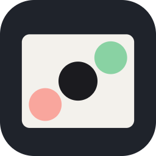

<p align="center"></p>

<h1 align="center">ArtFrames</h1>

<p align="center">Легка програма для класичної покадрової анімації: малюєш кадр за кадром, бачиш примари сусідніх кадрів, обводиш відео або домальовуєш приколи поверх нього.</p>

<p align="center"></p>
<p align="center"><sub>Кадр за кадром: <kbd>N</kbd> — новий кадр, попередні просвічують червоним, <kbd>Enter</kbd> — грати.</sub></p>

Для Windows, macOS і Linux. Без зайвих панелей: аркуш паперу на кожен кадр, калька, таймлайн і кілька пензлів, які приємно ведуть лінію пером.

## Що вміє

- **Калька (onion skin).** Попередні кадри просвічують червоним, наступні — зеленим. Скільки кадрів назад і вперед (0–5), колір і прозорість налаштовуються; <kbd>O</kbd> вмикає й вимикає.
- **Пензлі.** Кругла кисть і широка (плоска, як скошений маркер чи перо для каліграфії): лінія товща чи тонша залежно від напрямку руху, кут пера налаштовується. Плюс гумка. Розмір — окремо для кожного пензля, <kbd>[</kbd> <kbd>]</kbd>.
- **Тиск пера.** Планшет (Wacom, Huion, XP-Pen через Windows Ink) змінює товщину лінії. Кінчик-гумка пера стирає сам.
- **Таймлайн.** Додати, дублювати, видалити, перетягнути кадр мишею. **Утримання** кадру (на одиницях, двійках, трійках) — видно прямо на стрічці. Відтворення з будь-якою частотою кадрів, по колу.
- **Референс: картинка або відео під кадрами.** Відео йде синхронно з анімацією, точно кадр у кадр (також для 29.97 к/с). Прозорість, показати/сховати <kbd>R</kbd>, зі звуком під час відтворення. Просто перетягни файл у вікно.
- **Свій референс.** Окремий шар під усіма кадрами, який малюєш тими самими пензлями: каліграфія, траєкторія чи макет, а поверх — анімація. <kbd>Tab</kbd> перемикає, що малює пензель.
- **Експорт.** GIF, MP4, WebM, PNG-послідовність (можна з прозорим фоном). Поверх відео: відео під малюнком на повну яскравість, **звук зберігається**.
- **Проєкт** зберігається одним файлом `.artframes`. Раз на хвилину — автозбереження: якщо програма закрилася без збереження, наступного разу запропонує відновити.
- Віддзеркалення полотна <kbd>M</kbd>, піпетка <kbd>Alt</kbd>+клік, масштаб колесом, рух полотна пробілом або середньою кнопкою.

**Усе малюється на відеокарті (WebGL2).** Кожен кадр — текстура, штрих растеризують шейдери, а папір, референс, калька і малюнок складаються в один кадр прямо в роздільності екрана. Аркуш 3840×2160 з картинкою-референсом і калькою 2+2:

| | Попередня версія (Canvas 2D) | ArtFrames на GPU |
|---|---|---|
| Перегорнути кадр (<kbd>←</kbd> <kbd>→</kbd>) | 21 мс | **2,7 мс** |
| Повна перемальовка аркуша, час відеокарти | — | **0,07 мс** (найдовша 0,2) |
| Пензель 160 px під час малювання | 105–110 к/с без vsync | 105–110 к/с без vsync: в обох межа — потік подій пера, а не малювання |

Заміряно на 2× RTX 3090 (`npm run bench`, вертикальна синхронізація вимкнена). Із нормальним vsync малювання тримає частоту монітора без жодного пропущеного кадру.

## Малювати поверх відео

<p align="center"></p>
<p align="center"><sub>Відео під кадрами: ковпак домальовано на кожному кадрі (на трійках), потім він їде разом із відео.</sub></p>

1. <kbd>Ctrl+I</kbd> або перетягни відео у вікно (MP4, MOV, WebM, MKV).
2. Якщо в проєкті ще нічого не намальовано, він сам підлаштується під відео: той самий розмір, та сама частота кадрів, а таймлайн розтягнеться на всю довжину (кадри на двійках — перемкни «Новий кадр ×1», щоб малювати на кожному кадрі відео).
3. Стрілками переходиш по кадрах — відео стає точно на відповідний кадр. Малюєш.
4. <kbd>Ctrl+E</kbd> → MP4 → «Підкласти референс», «Звук із відео» → готовий ролик з каракулями й оригінальним звуком.

Для обведення руху (ротоскоп) зменш прозорість відео до 30–50 % і вимкни «Підкласти референс» при експорті — вийде чиста анімація на білому.

## Свій референс

<p align="center"></p>
<p align="center"><sub><kbd>Tab</kbd> — каліграфія широким пером на своєму референсі, <kbd>Tab</kbd> — назад до кадрів, і м'ячик біжить по ній.</sub></p>

Окремий шар під усіма кадрами, на якому малюєш тими самими пензлями: каліграфію, яку потім оживлятимеш, траєкторію руху, макет сцени.

1. <kbd>Tab</kbd> або кнопка «Референс» угорі — тепер пензель малює референс. Щоб не сплутати, полотно обведене синім, згори напис, а таймлайн притухає.
2. Малюєш. Широка кисть під кутом — це і є перо для каліграфії.
3. <kbd>Tab</kbd> ще раз — назад до кадрів. Референс лежить під кожним кадром (над картинкою чи відео, якщо вони є) з прозорістю, яку задаєш у панелі. <kbd>Shift+R</kbd> ховає його.
4. «Кадр → реф.» додає малюнок поточного кадру в референс, «Реф. → кадр» — навпаки, під малюнок кадру. <kbd>Delete</kbd> у режимі референсу очищає саме референс. Усе скасовується через <kbd>Ctrl+Z</kbd>.

Референс зберігається в проєкті. В експорт він не йде, доки не ввімкнеш «Підкласти свій референс». Тоді він ляже під кожен кадр на повну яскравість, наприклад щоб каліграфія лишилася в кадрі.

## Клавіші

| Клавіша | Що робить |
|---|---|
| <kbd>B</kbd> / <kbd>F</kbd> / <kbd>E</kbd> | Кругла кисть / широка кисть / гумка |
| <kbd>[</kbd> <kbd>]</kbd> | Менша / більша кисть |
| <kbd>1</kbd>–<kbd>6</kbd> | Колір: графіт, синій олівець, червоний, зелений, жовтий, білий. <kbd>Alt</kbd>+клік — піпетка |
| <kbd>N</kbd> | Новий порожній кадр після поточного |
| <kbd>D</kbd> | Дублювати кадр |
| <kbd>Tab</kbd> | Малювати свій референс / назад до кадрів |
| <kbd>Delete</kbd> / <kbd>Shift+Delete</kbd> | Очистити кадр (у режимі референсу — референс) / видалити кадр |
| <kbd>←</kbd> <kbd>→</kbd> (або <kbd>,</kbd> <kbd>.</kbd>), <kbd>Home</kbd> <kbd>End</kbd> | По кадрах |
| <kbd>Alt+←</kbd> <kbd>Alt+→</kbd> | Пересунути кадр |
| <kbd>−</kbd> <kbd>=</kbd> | Утримання кадру коротше / довше |
| <kbd>Пробіл</kbd> | Грати / пауза; затиснути й тягнути — рух полотна |
| <kbd>O</kbd> / <kbd>R</kbd> / <kbd>Shift+R</kbd> / <kbd>M</kbd> | Калька / референс / свій референс / дзеркало |
| Колесо, <kbd>0</kbd> | Масштаб, вмістити в екран |
| <kbd>Ctrl+Z</kbd> / <kbd>Ctrl+Shift+Z</kbd> | Скасувати / повторити |
| <kbd>Ctrl+S</kbd> <kbd>Ctrl+O</kbd> <kbd>Ctrl+N</kbd> | Зберегти / відкрити / новий проєкт |
| <kbd>Ctrl+I</kbd> / <kbd>Ctrl+E</kbd> | Референс / експорт |
| <kbd>F1</kbd> | Усі клавіші |

Клавіші працюють і на українській розкладці.

## Встановлення

Завантаж файл для своєї системи з [останнього релізу](../../releases/latest):

| Система | Файл | Як встановити |
|---|---|---|
| **Windows** 10/11 | `ArtFrames-Setup-<версія>.exe` | Двічі клікни — встановиться за кілька секунд і запуститься. Права адміністратора не потрібні, видалення — через «Програми». Файли `.artframes` відкриваються подвійним кліком. |
| **macOS** Apple Silicon | `ArtFrames-<версія>-arm64.dmg` | Відкрий і перетягни ArtFrames в Applications. |
| **macOS** Intel | `ArtFrames-<версія>-x64.dmg` | Те саме. |
| **Linux** | `ArtFrames-<версія>-x86_64.AppImage` | `chmod +x ArtFrames-*.AppImage` і запусти. |
| **Linux** Debian / Ubuntu | `ArtFrames-<версія>-amd64.deb` | `sudo apt install ./ArtFrames-*.deb` |

Програма не підписана платним сертифікатом: Windows може показати «Windows захистив ваш ПК» → «Докладніше» → «Усе одно запустити»; на macOS перший раз — правий клік по ArtFrames → «Відкрити».

## Файл проєкту

`.artframes` — це JSON: розмір, частота кадрів, колір паперу, утримання кожного кадру і сам малюнок як PNG. Свій референс — ще один PNG із прозорістю й видимістю. Картинка-референс вшивається в проєкт, відео — ні (лише шлях до нього, щоб файл проєкту лишався легким). Якщо відео перемістити, проєкт відкриється без нього, а програма скаже, якого файлу бракує.

## Підтримати

ArtFrames безкоштовний і з відкритим кодом. Підтримати автора можна кнопкою ♥ у правому верхньому куті програми (там QR-коди) або тут:

| Монета | Мережа | Адреса |
|---|---|---|
| USDT | лише Tron (TRC20) | `TLzNJFQUgD7AqqdCggQdm7ogX4UPHrmZqV` |
| BTC | лише Bitcoin | `115jhb9iiWF99C5uaC6N27T4QVLmkmY2E8` |
| USDC | лише BNB Smart Chain (BEP20) | `0x87d6a63b18b351d34211cc4b04e28494c1eb963a` |
| SOL | лише Solana | `E2duNyxT8zmqEUwFuupoi8xJHBH4bt1axStYKrhS3M4x` |
| ADA | лише Cardano | `addr1vylp2e0g50p029ar76rvtavwq0wrazh63a60uazju482k2gz96gpm` |

Надсилай кожну монету тільки в зазначеній мережі: переказ через іншу мережу загубиться.

## Запуск із коду

Потрібен [Node.js](https://nodejs.org) 20+.

```bash
git clone https://github.com/artsocity23-ux/artframes.git
cd artframes
npm install
npm start
```

`npm run dist` збирає інсталятор для поточної системи в `dist/`. Інсталятори для всіх трьох систем збирає GitHub Actions (`.github/workflows/build.yml`): тег `v*` публікує їх у реліз.

## Як влаштовано

- **Electron**, без збирача: інтерфейс — звичайні ES-модулі.
- **GPU** (`src/gpu.js`, WebGL2). Кожен кадр — текстура розміру проєкту, створюється лише тоді, коли на ньому щось намальовано, тож сотні порожніх кадрів під довге відео нічого не коштують. Сцена (папір, референс, свій референс, калька з тонуванням, малюнок і штрих, що малюється) складається шейдером одразу на екран, у його роздільності; коли аркуш зменшено, текстури беруться з mipmap-рівнів, тож тонкі лінії не «сиплються». Undo, дублювання, очищення кадру й перенесення «кадр ↔ свій референс» — копії й змішування текстур, без читання на процесор. Свій референс — така сама текстура, як кадр, тільки не на таймлайні.
- **Пензлі** (`src/brush.js` + шейдери): точки пера згладжуються й з'єднуються квадратичними кривими; кожен шматок штриха йде на GPU одним інстансом: кругла кисть — «капсула» з різними радіусами на кінцях (тиск), широка — опукла оболонка прямокутного пера у двох положеннях. Шейдер рахує точну відстань до фігури (SDF) і пише покриття в маску штриха з MAX-змішуванням: шматки зливаються в одну фігуру з чистим згладжуванням, без швів і без `shadowBlur`. Коли перо піднято, маска запікається в кадр одним проходом.
- **Відео** (`src/video.js`) декодується через WebCodecs бібліотекою [Mediabunny](https://mediabunny.dev): точний кадр за часом, кеш і передзавантаження сусідніх кадрів, файл читається шматками, тож навіть довге відео не лягає в пам'ять цілком.
- **Експорт** (`src/exporter.js`): кожен кадр складається на GPU й іде енкодеру сирими пікселями. MP4/WebM — Mediabunny (H.264/VP9; поверх відео — конвертація з копіюванням звукової доріжки), GIF — [gifenc](https://github.com/mattdesl/gifenc).

| Файл | |
|---|---|
| `main.js` | вікно, діалоги файлів, читання відео шматками, збереження проєктів і автозбереження |
| `index.html` / `app.css` / `src/app.js` | редактор: кадри, свій референс, калька, таймлайн, відтворення, клавіші |
| `src/gpu.js` | рендер на відеокарті: текстури кадрів, шейдери пензлів і сцени |
| `src/brush.js` | пензлі: згладжування, криві, геометрія для шейдерів |
| `src/video.js` | відео-референс |
| `src/exporter.js` | PNG, GIF, MP4, WebM |
| `donate.html` / `donate.js` / `donate.json` | вікно «Підтримати»; порожні пункти в `donate.json` не показуються |
| `selftest.js` / `bench.js` | наскрізний тест без людини / заміри швидкості |
| `demo.js` | запис демо-GIF для цього README |
| `make-icon.js` | генерує іконки, зокрема `build/icon.png` для інсталяторів |

## Самоперевірка

```bash
npm run selftest
```

Малює справжніми подіями миші й пера з тиском (м'ячик на кількох кадрах, обидва пензлі), перевіряє кальку, undo, операції з кадрами й відтворення, генерує тестові відео (24 і 29.97 к/с, зі звуком), малює поверх них і експортує PNG, GIF, WebM і MP4. Окремо перевіряє свій референс: що він не чіпає кадрів, видний під ними, ховається, скасовується, переноситься в кадр і назад, іде в експорт лише за запитом і зберігається в проєкті. Окремо міряє, чи встигає велика кисть на 4K-полотні за монітором. Результат — `selftest-out/report.json` і скріншоти.

```bash
npm run bench
```

Заміри швидкості з вимкненою вертикальною синхронізацією на важкому аркуші (4K, картинка-референс, калька 2+2): кадри за секунду під час малювання, час перегортання кадру, час відеокарти на перемальовку. Результат — `bench-out/bench.json`.

```bash
npm run demo
```

Записує GIF, які є в цьому README: справжнє вікно програми, справжні події пера з тиском, приблизно 13 кадрів на секунду. Відео для третьої GIF генерується на місці. Від себе запис додає лише підпис із клавішею внизу. Результат — `demo-out/*.gif`.

## Ліцензія

[MIT](LICENSE). Mediabunny — MPL-2.0, gifenc — MIT.
